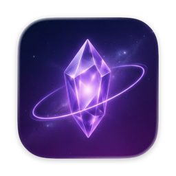
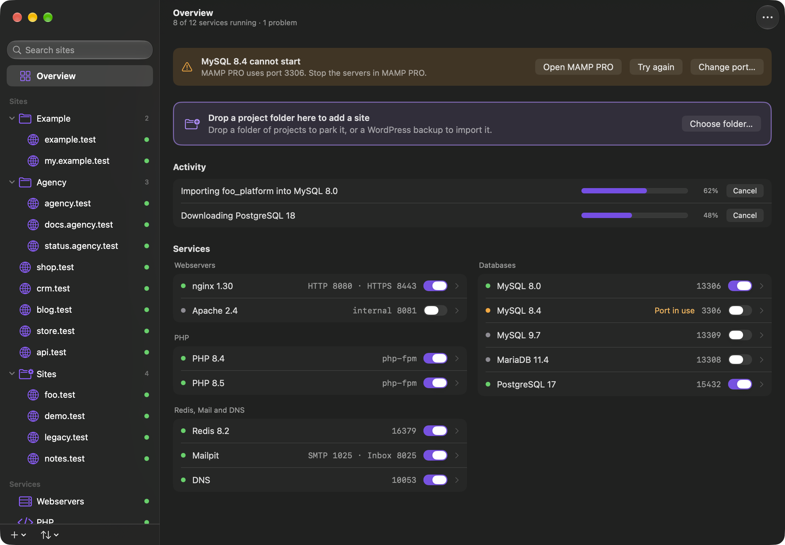
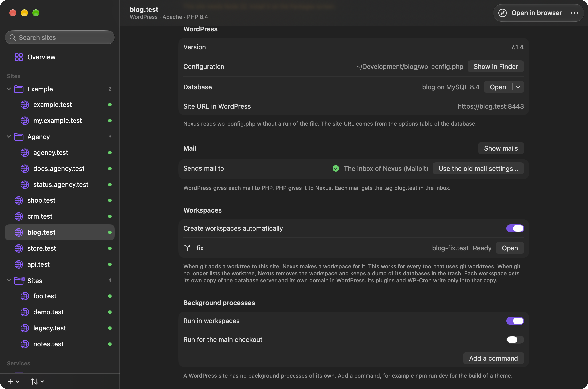
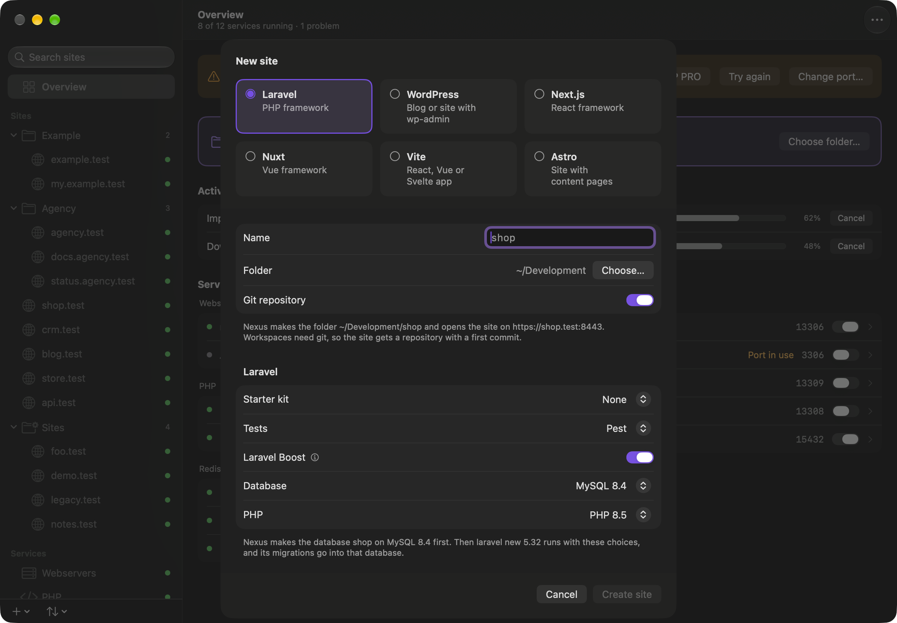
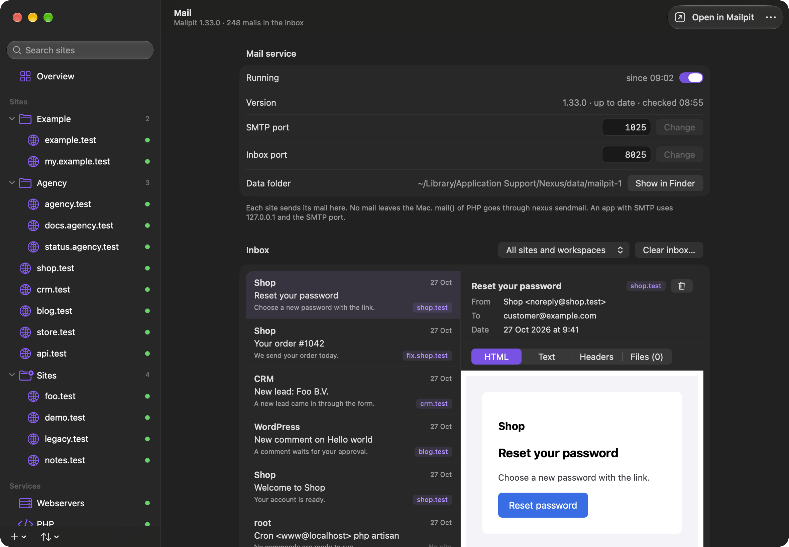
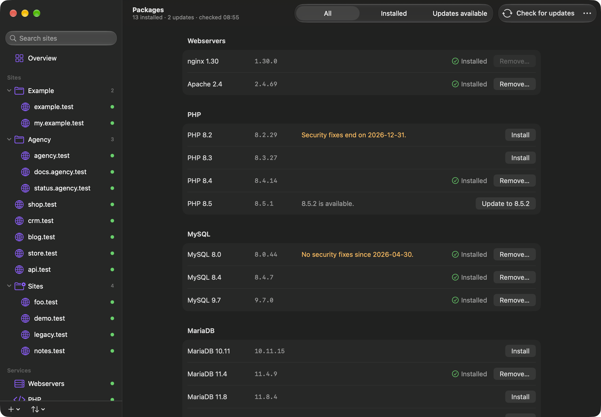

<p align="center">
  
</p>

<h1 align="center">Nexus</h1>

<p align="center">
  <b>Your local websites on the Mac. PHP, Node, WordPress and databases in one app.</b><br>
  Free and open source. No paywall, ever.
</p>

<p align="center">
  <a href="https://github.com/NexusLocal/nexus/releases/latest/download/Nexus.dmg"><b>Download Nexus</b></a>
  ·
  <a href="https://github.com/NexusLocal/nexus/releases/latest">What is new</a>
  ·
  <a href="#install">Install</a>
  ·
  <a href="#feedback">Feedback</a>
</p>

<p align="center">
  <sub>Public beta · Mac with Apple silicon · macOS 27 or later · MIT license</sub>
</p>



## Why Nexus

- 🔒 **HTTPS for every site.** Each site gets a `.test` domain with a trusted certificate.
- ⚡ **Every service in one click.** PHP, Node, nginx, Apache, MySQL, MariaDB, PostgreSQL, Redis, DNS
  and mail. Choose the versions that you need.
- 🌳 **A workspace for each git worktree.** Each branch gets its own database server, domain, Redis
  indexes and workers. So several Claude Code sessions can work at the same time.
- 🧱 **WordPress, done right.** Bedrock, multisite on subdomains and WP-CLI. Change the URLs in one
  click. Changed your mind? Undo it.
- 📥 **Import a WordPress backup.** From Local, Studio, Jetpack or All-in-One WP Migration.
- ✨ **A new site in one click.** Laravel, WordPress, Next.js, Nuxt, Vite or Astro.
- 📬 **A mail inbox for every site.** Built on Mailpit. No test mail ever reaches a real customer.
- 💜 **Free and open source.** MIT license. No subscription and no paywall, ever.

## 🌳 A workspace for each branch



Make a git worktree of a site. Nexus makes the workspace by itself:

```sh
git worktree add ../shop-ticket-1 -b ticket-1
cd ../shop-ticket-1
nexus workspace wait
```

The last command prints the URL, for example `https://shop-ticket-1.test`.

Each workspace gets:

- **Database:** a server of its own on a copy of your data. You can also start with an empty
  database. Then your migrations and seeders run from zero. An agent never sees customer data.
- **Domain:** a `.test` domain of its own with HTTPS.
- **Redis:** indexes of its own.
- **Programs:** its own queue worker, scheduler, Reverb server and Vite server, when the application
  uses them.

A new worktree is ready within seconds, also with a large database. When you remove the worktree,
Nexus removes the workspace. It keeps a dump of its databases in the trash for 7 days.

<details>
<summary><b>How a workspace works</b></summary>

<br>

In a Laravel application:

- **Database:** the server runs on a clone of the data folder. Your database names stay the same.
  Only the connection keys in `.env` change. Nexus then asks the application which server it reaches.
- **Files:** Nexus clones `vendor`, `node_modules`, the build output and `storage/app`. The clones use
  almost no disk until a file changes.
- **Migrations:** `php artisan migrate --force` runs after the clone. You can change this list on the
  Site screen.

A WordPress site gets its own database and its own domain in WordPress. Its plugins and WP-Cron write
only into that copy. A Node.js app gets its own database too.

Each workspace server uses about 200 MB of memory.

For the clone, Nexus freezes MySQL and MariaDB for about a second. A writer waits and then continues.
PostgreSQL needs no freeze. When the freeze fails, the workspace shows Not isolated with the reason.
Retry tries again. A workspace that is not isolated runs no programs and no commands.

A database name stays the same in a workspace. So a command that connects itself must use
`{port:database}`, the port of the database server of the workspace.

To get a dump back, run `nexus db dumps` and `nexus db restore`.

A site can add its own keys to the `.env` of each workspace:

```sh
nexus site edit shop.test --workspace-key SCOUT_PORT={port:scout}
```

</details>

## 🧱 WordPress, done right

- Nexus finds WordPress and Bedrock sites. It gives them the right web rules on nginx and Apache.
- The Site screen shows the version, the database and the configuration. It sets up `wp-config.php`
  or a database for you.
- Multisite works, also on subdomains.
- `nexus wp` runs WP-CLI with the PHP version of the site.
- Change the URLs of a site to its Nexus URL in one click. Undo it with one click too.
- Nexus warns when a plugin sends real mail. It can turn that plugin off for you.

**📥 Import a site:** drop a backup on the Overview. Nexus reads exports of Local, Studio and Jetpack,
`.wpress` files of All-in-One WP Migration and a folder with a dump. It makes the site, the database
and a git repository. Then it changes the URLs. In the terminal: `nexus import`.

## ✨ A new site in one click



Laravel (with its starter kits), WordPress, Next.js, Nuxt, Vite and Astro. Nexus makes the folder, the
database and a git repository. Then it opens the site over HTTPS. In the terminal: `nexus new`.

## 📬 A mail inbox for every site



Nexus installs and runs [Mailpit](https://github.com/axllent/mailpit) for you. Every mail that your
sites send goes to its inbox. No mail leaves your Mac. Each mail shows the site or the workspace that
sent it. Read your mails in Nexus, or open the web inbox of Mailpit.

## 📦 The versions that you need



Install a version of PHP, Node or a database with one click. Nexus shows the updates. It also tells
you when a version gets no more security fixes.

## Install

You need:

- A Mac with Apple silicon
- macOS 27 or later
- git, for workspaces

Then:

1. Download [`Nexus.dmg`](https://github.com/NexusLocal/nexus/releases/latest/download/Nexus.dmg)
   from the [latest release](https://github.com/NexusLocal/nexus/releases/latest).
2. Move Nexus to the Applications folder and open it.
3. Follow the first steps of the app:
   - Allow Nexus to run in the background. The helper sends each `.test` name to Nexus.
   - Trust the Nexus certificate. macOS asks for your password one time.
   - Tell Nexus what you build. Nexus then chooses the versions of PHP, Node and the databases.
   - Click Done. Nexus starts the services that you chose.

Nexus updates itself. See Settings > Updates.

## Add a site

Click + in the sidebar and choose the folder of your project. You can also use the command line:

```sh
cd ~/Sites/shop
nexus site add . --php 8.4
```

The site opens on `https://shop.test`. To make each folder in `~/Sites` a site, run `nexus park ~/Sites`.

## Bring a database

Open a database service in the app and choose Import database. You can also run this command:

```sh
nexus db copy shop --to mysql-8.4
```

Nexus reads the other server and changes nothing on it. The default account of a new instance is
`root` without a password.

## Command line

Turn on Add Nexus to PATH in the settings of Nexus. Then you can use the `nexus` command in your
terminal. Run `nexus --help` for all commands, or open the Command line page in the app.

```sh
nexus status                  # the services and their state
nexus site list               # the sites
nexus workspace list          # the workspaces
nexus workspace info --json   # the URL, the databases and the ports of a workspace
nexus php -v                  # the PHP of the site in this folder
nexus composer install        # Composer with that PHP
nexus wp plugin list          # WP-CLI with that PHP
```

## Feedback

Nexus is in public beta. Your honest feedback makes it better, also when it is negative.

- 🐛 Did you find a bug? [Open an issue](https://github.com/NexusLocal/nexus/issues/new?template=bug_report.yml).
- 💡 Do you need a feature? [Ask for it](https://github.com/NexusLocal/nexus/issues/new?template=feature_request.yml).
- 🗺️ What comes next? See the [roadmap](ROADMAP.md).
- ⭐ Do you like Nexus? Give it a star on GitHub. A star helps other developers find Nexus.

## Privacy

- **Crash reports:** Nexus sends anonymous crash reports. Turn them off in Settings > Advanced.
- **Activity log:** Nexus writes what happens to
  `~/Library/Application Support/Nexus/logs/activity.log`. So you can see what went wrong. The log
  holds the names of the buttons that you click, the requests to `nexusd` and their results. It does
  not hold typed text, passwords or `.env` values. The file stays on your Mac. Nexus keeps at most
  about 10 MB. To open it, use the "..." menu on the Overview screen.

## Uninstall

Open Settings > Advanced and click Uninstall. Nexus then moves itself to the Trash. You can also run
`nexus uninstall` and move Nexus to the Trash yourself. Your packages and databases stay in
`~/Library/Application Support/Nexus` until you delete that folder.

## Build from source

You need Xcode 27. Copy `Config/Signing.local.xcconfig.example` to `Config/Signing.local.xcconfig`.
Set your team and open `Nexus.xcodeproj`.

## License

Nexus is free and open source under the [MIT license](LICENSE).
