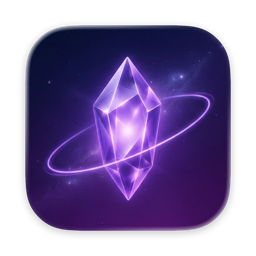
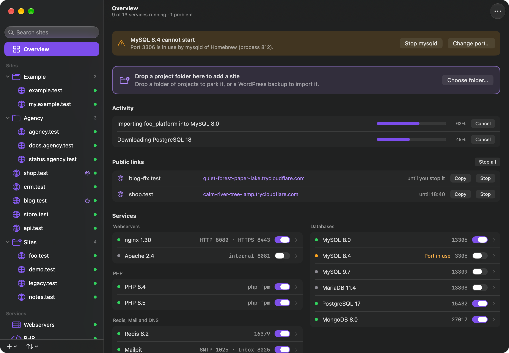
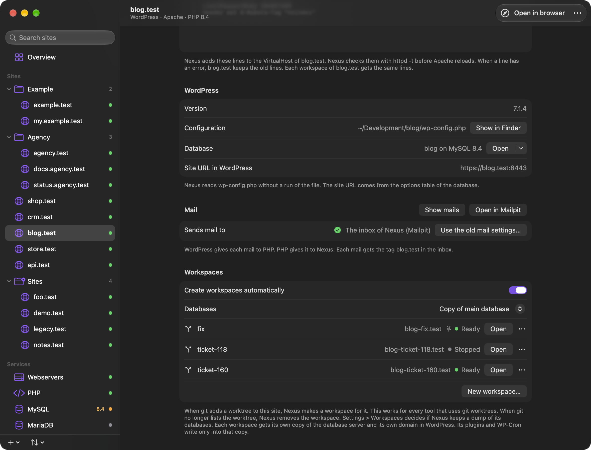
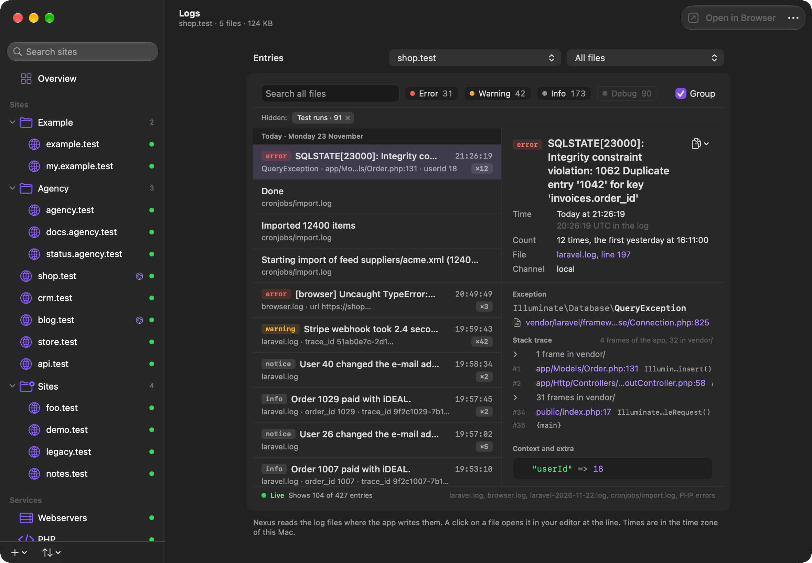
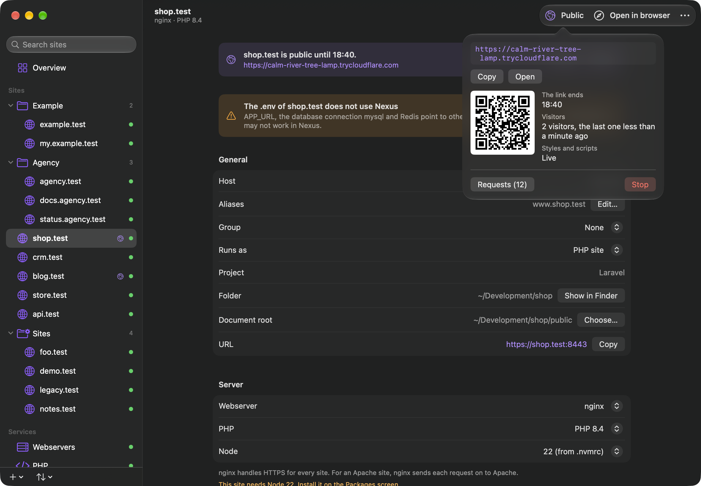
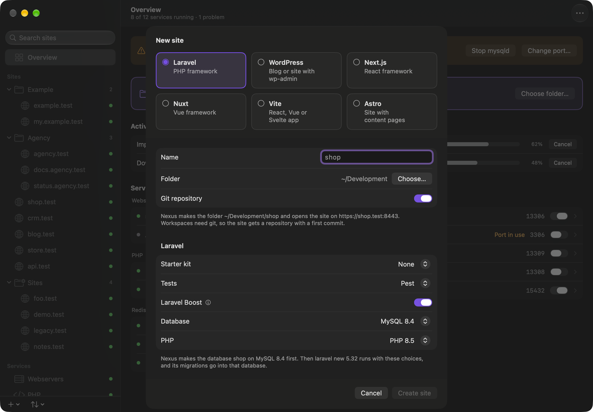
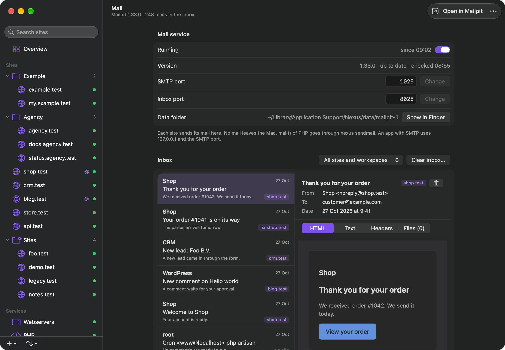
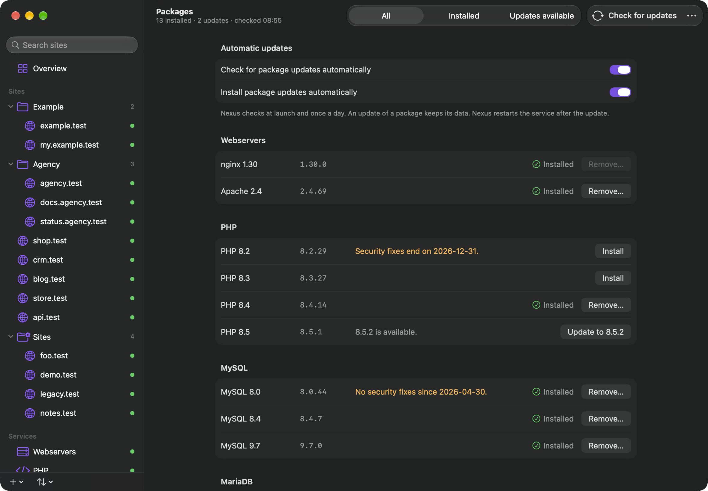

<p align="center">
  
</p>

<h1 align="center">Nexus</h1>

<p align="center">
  <b>Your local websites on the Mac. PHP, Node, WordPress and databases in one app.</b><br>
  Free and open source. No paywall, ever.
</p>

<p align="center">
  <a href="https://github.com/NexusLocal/nexus/releases/latest/download/Nexus.dmg"><b>Download Nexus</b></a>
  ·
  <a href="https://github.com/NexusLocal/nexus/releases">What is new</a>
  ·
  <a href="#install">Install</a>
  ·
  <a href="#feedback">Feedback</a>
</p>

<p align="center">
  <sub>Public beta · Mac with Apple silicon · macOS 27 or later · MIT license</sub>
</p>



## Why Nexus

- 🔒 **HTTPS for every site.** Each site gets a `.test` domain with a trusted certificate.
- ⚡ **Every service in one click.** PHP, Node, nginx, Apache, MySQL, MariaDB, PostgreSQL, MongoDB,
  Redis, DNS and mail. Choose the versions that you need.
- 🌳 **A workspace for each branch.** Each branch gets its own database server, domain, Redis indexes
  and workers. It starts with a copy of your data, an empty database or your own dump file. So
  several Claude Code sessions can work at the same time. A workspace that nobody uses stops by
  itself.
- 🤖 **Made for coding agents.** Claude Code and Codex use Nexus through its MCP server. They read
  the errors, the dumps and the mail of your sites. You decide what an agent can do.
- 🐞 **See what your code does.** Each `dump()`, query, log line and queue job of a request in one
  place. Xdebug runs only when you debug.
- 📜 **The logs of your apps.** `laravel.log`, the `debug.log` of WordPress and the PHP errors of each
  site, live, with a filter by level and a search over all files.
- 🔗 **Share a site with one click.** Send a client or your phone a public link to a local site. With
  a password, hidden errors and the requests of each webhook.
- 🧱 **WordPress, done right.** Bedrock, multisite on subdomains and WP-CLI. Change the URLs in one
  click. Changed your mind? Undo it.
- 📥 **Import a WordPress backup.** From Local, Studio, Jetpack or All-in-One WP Migration.
- ✨ **A new site in one click.** Laravel, WordPress, Next.js, Nuxt, Vite or Astro.
- 📬 **A mail inbox for every site.** Built on Mailpit. No test mail ever reaches a real customer.
- 💜 **Free and open source.** MIT license. No subscription and no paywall, ever.

## 🌳 A workspace for each branch



In the folder of a site, make a workspace for a branch:

```sh
nexus workspace create ticket-1
nexus workspace wait ticket-1
```

Nexus makes the git worktree and the workspace. The last command prints the URL, for example
`https://shop-ticket-1.test`. "New workspace…" on the Site screen does the same. A worktree that you
or an agent make with `git worktree add` gets a workspace too.

Each workspace gets:

- **Database:** a server of its own on a copy of your data. You can also start with an empty
  database. Then your migrations and seeders run from zero. Or each workspace loads your own dump
  file, for example a scrubbed copy of production. With these two choices an agent never sees
  customer data.
- **Domain:** a `.test` domain of its own with HTTPS.
- **Redis:** indexes of its own.
- **Programs:** its own queue worker, scheduler, Reverb server and Vite server, when the application
  uses them.

A new worktree is ready within seconds, also with a large database. When you remove the worktree,
Nexus removes the workspace. By default it keeps a dump of its databases in the trash for 7 days.

- **Idle workspaces stop.** A workspace without activity stops after 1 hour. The next page, command
  or database connection starts it again. Settings > Workspaces sets the time.
- **Dev servers on demand.** Vite and the app of a Node.js site start with the first page. They stop
  when no page needs them.
- **Old workspaces go.** The Site screen names the workspaces without activity for some days.
  Review… shows what git knows about each one, for example merged or not pushed. You choose which
  ones go. Nexus never removes a workspace by itself.

<details>
<summary><b>How a workspace works</b></summary>

<br>

In a Laravel application:

- **Database:** the server runs on a clone of the data folder. Your database names stay the same.
  Only the connection keys in `.env` change. Nexus then asks the application which server it reaches.
- **Files:** Nexus clones `vendor`, `node_modules`, the build output and `storage/app`. The clones use
  almost no disk until a file changes.
- **Migrations:** `php artisan migrate --force` runs after the clone. You can change this list on the
  Site screen.

A WordPress site gets its own database and its own domain in WordPress. Its plugins and WP-Cron write
only into that copy. A Node.js app gets its own database too.

A MongoDB connection gets the same URL with the port of the workspace, for example in `MONGODB_URI`.
A URL of MongoDB Atlas (`mongodb+srv`) stays as it is. So that workspace shares the Atlas database
with the main site, and Nexus tells you so.

Each workspace server uses about 200 MB of memory.

For the clone, Nexus freezes MySQL, MariaDB and MongoDB for about a second. A writer waits and then
continues. PostgreSQL needs no freeze. When the freeze fails, the workspace shows Not isolated with
the reason. Retry tries again. A workspace that is not isolated runs no programs and no commands.

A database name stays the same in a workspace. So a command that connects itself must use
`{port:database}`, the port of the database server of the workspace.

To get a dump back, run `nexus db dumps` and `nexus db restore`.

A site can add its own keys to the `.env` of each workspace:

```sh
nexus site edit shop.test --workspace-key SCOUT_PORT={port:scout}
```

</details>

## 🤖 Made for coding agents

Nexus has an MCP server for Claude Code, Codex and other coding agents. The Agents screen under Tools
turns it on for each agent that Nexus finds. An agent then works with your sites as you do:

- **Errors first.** When a page fails, the agent reads the newest errors of the site.
- **Mail from start to end.** The agent fills in a sign-up form, waits for the mail and opens the link
  in it. No mail leaves your Mac.
- **Workspaces.** In a git worktree the agent uses the URL and the database of that workspace.
- **Dumps.** The agent reads the dumps, the queries and the log lines of a request.
- **Logs.** The agent reads the log files of the app of a site, for example only the errors.
- **You decide.** An agent can only look, look and set up, or also remove. No agent can delete a
  database or your files.
- **Safe tests.** When the tests of a Laravel site use your development database, Nexus warns you
  and the agent. "Choose test database…" on the Site screen makes a separate one.

## 🐞 Dumps, queries and Xdebug

The Dumps screen under Tools shows each `dump()` and `dd()` of your PHP sites. With each request it
shows the queries, the log lines and the queue jobs. Nexus marks a slow query, a duplicate query and
an N+1 query. A click on a file opens your code editor at that line.

- **Off by default.** Turn on the Catch switches on the Dumps screen. Until then PHP runs your sites
  without the dump viewer.
- **API answers stay valid.** A page in your browser shows each dump. An API answer or an update of
  Livewire, Inertia, htmx or Turbo stays clean.
- **In the terminal and the browser.** `nexus dumps --follow` shows each new dump. `nexus dumps open`
  opens a web page with the same list.
- **Xdebug only when you debug.** Only a request that starts a debug session uses Xdebug. So your
  normal pages stay fast. `nexus debug artisan my:command` runs one command with Xdebug.

## 📜 The logs of your apps



The Logs screen under Tools shows the log files of the app of each site and workspace: `storage/logs`
of Laravel, the `debug.log` of WordPress, the PHP errors with their time, the output of a Node.js
app and the requests. A new entry shows at once. "Show logs" in the menu of a site opens it.

- **Easy to read.** Each level has its color, each day has its line, and each time is the time of
  your Mac. An exception shows the line of your app first. The frames in `vendor/` fold into one row.
- **Find it.** Filter by level, search all files at once, or find all entries with the same
  `trace_id`. Equal entries show as one row with a count. The entries of your test runs stay hidden
  until you want them.
- **Large logs too.** A log of 281 MB opens in a moment.
- **In the terminal, the browser and your agent.** `nexus logs --level error --follow` shows each
  new error. The web page of the dumps has a Logs page. Agents read the logs through the MCP server.

## 🔗 Share a site



Click Share on the Site screen, or run `nexus share` in the folder of a site. Nexus opens a public
link through Cloudflare. You need no account. Send the address to a client, a colleague or your
phone.

- **Visitors see only the site.** Error details and tools such as Telescope stay hidden. A password
  keeps other people out. Webhooks still reach the site.
- **The site works through the link.** Laravel sees the public address. Nexus changes the addresses
  in the pages of WordPress and other sites. Vite keeps hot reload on for you.
- **Check a webhook.** The dump viewer can keep each request of a link with its headers, its body
  and its dumps.
- **Your own domain.** With a domain at Cloudflare a link keeps a fixed address, for example
  `shop.example.com`.

## 🧱 WordPress, done right

- Nexus finds WordPress and Bedrock sites. It gives them the right web rules on nginx and Apache.
- The Site screen shows the version, the database and the configuration. It sets up `wp-config.php`
  or a database for you.
- Multisite works, also on subdomains.
- `nexus wp` runs WP-CLI with the PHP version of the site.
- Change the URLs of a site to its Nexus URL in one click. Undo it with one click too.
- Give each workspace a dump of your live site. Nexus changes the links to the live URL while the
  dump loads, also in serialized data and JSON. So the workspace opens with its own URL at once.
- Nexus warns when a plugin sends real mail. It can turn that plugin off for you.

**📥 Import a site:** drop a backup on the Overview. Nexus reads exports of Local, Studio and Jetpack,
`.wpress` files of All-in-One WP Migration and a folder with a dump. It makes the site, the database
and a git repository. Then it changes the URLs. In the terminal: `nexus import`.

## ✨ A new site in one click



Laravel (with its starter kits), WordPress, Next.js, Nuxt, Vite and Astro. Nexus makes the folder, the
database and a git repository. Then it opens the site over HTTPS. In the terminal: `nexus new`.

## 📬 A mail inbox for every site



Nexus installs and runs [Mailpit](https://github.com/axllent/mailpit) for you. Every mail that your
sites send goes to its inbox. No mail leaves your Mac. Each mail shows the site or the workspace that
sent it. Read your mails in Nexus, or open the web inbox of Mailpit.

## 📦 The versions that you need



Install a version of PHP, Node or a database with one click. Updates in the same version line install
by themselves, for example a security fix of PHP. Nexus also tells you when a version gets no more
security fixes.

## Install

You need:

- A Mac with Apple silicon
- macOS 27 or later
- git, for workspaces

Then:

1. Download [`Nexus.dmg`](https://github.com/NexusLocal/nexus/releases/latest/download/Nexus.dmg)
   from the [latest release](https://github.com/NexusLocal/nexus/releases/latest).
2. Move Nexus to the Applications folder and open it.
3. Follow the first steps of the app:
   - Allow Nexus to run in the background. The helper sends each `.test` name to Nexus.
   - Trust the Nexus certificate. macOS asks for your password one time.
   - Tell Nexus what you build. Nexus then chooses the versions of PHP, Node and the databases.
   - Click Done. Nexus starts the services that you chose.

Nexus updates itself. See Settings > Updates.

## Add a site

Click + in the sidebar and choose the folder of your project. You can also use the command line:

```sh
cd ~/Sites/shop
nexus site add . --php 8.4
```

The site opens on `https://shop.test`. To make each folder in `~/Sites` a site, run `nexus park ~/Sites`.

When the `.env` of a Laravel site points to another server on your Mac, the Site screen says so.
"Use Nexus…" shows each key with its old and its new value. Nexus can copy your data first.

Each PHP site can have its own nginx or Apache lines, for example `client_max_body_size 100m;`. Write
them on the Site screen or with `nexus site lines`. Nexus checks them before it uses them.

## Bring a database

Open a database service in the app and choose Import database. Copy a database from another server,
for example from Docker or MongoDB Atlas. Or load a dump file: `.sql`, `.sql.gz`, a `.zip` or `.tar`
with a dump, or an archive of `mongodump --archive`. In the terminal:

```sh
nexus db copy shop --to mysql-8.4         # from another server
nexus db import ~/Downloads/shop.sql.gz   # into the database of the site in this folder
```

Nexus reads the other server and changes nothing on it. A database that exists changes only after
your choice. Nexus then puts a copy of the old database in the trash first. The default account of a
new instance is `root` without a password.

Each MongoDB runs as a replica set of one server. So transactions work, for example
`DB::transaction` of Laravel and the nested writes of Prisma.

## Command line

Turn on Add Nexus to PATH on the Command line screen of Nexus. Then you can use the `nexus` command in
your terminal. Run `nexus --help` for all commands, or see the Command line screen.

```sh
nexus status                  # the services and their state
nexus site list               # the sites
nexus workspace list          # the workspaces
nexus workspace info --json   # the URL, the databases and the ports of a workspace
nexus workspace list --old    # the workspaces without activity for some days
nexus php -v                  # the PHP of the site in this folder
nexus composer install        # Composer with that PHP
nexus wp plugin list          # WP-CLI with that PHP
nexus errors                  # the newest errors of the site in this folder
nexus dumps --follow          # each new dump of your sites
nexus logs --level error      # the newest errors in the log files of the app in this folder
nexus share                   # a public link to the site in this folder
nexus debug artisan my:task   # one command with Xdebug
```

## Feedback

Nexus is in public beta. Your honest feedback makes it better, also when it is negative.

- 🐛 Did you find a bug? [Open an issue](https://github.com/NexusLocal/nexus/issues/new?template=bug_report.yml).
- 💡 Do you need a feature? [Ask for it](https://github.com/NexusLocal/nexus/issues/new?template=feature_request.yml).
- 🗺️ What comes next? See the [roadmap](ROADMAP.md).
- ⭐ Do you like Nexus? Give it a star on GitHub. A star helps other developers find Nexus.

## Privacy

- **Crash reports:** Nexus sends anonymous crash reports. Turn them off in Settings > Advanced.
- **Activity log:** Nexus writes what happens to
  `~/Library/Application Support/Nexus/logs/activity.log`. So you can see what went wrong. The log
  holds the names of the buttons that you click, the requests to `nexusd` and their results. It does
  not hold typed text, passwords or `.env` values. The file stays on your Mac. Nexus keeps at most
  about 10 MB. To open it, use the "..." menu on the Overview screen.

## Security

- **Signed packages:** Nexus downloads nginx, PHP, the databases and the other packages from
  [NexusLocal/binaries](https://github.com/NexusLocal/binaries). The maintainer signs each list of
  packages outside GitHub. Nexus installs only from a list with a valid signature, and it refuses a
  list that is older than the last one it read. Nexus checks the SHA-256 of each download against
  that list.
- **Sources:** The build of each package checks its sources against the checksum or the PGP
  signature of the publisher.

## Uninstall

Open Settings > Advanced and click Uninstall. Nexus then moves itself to the Trash. You can also run
`nexus uninstall` and move Nexus to the Trash yourself. Your packages and databases stay in
`~/Library/Application Support/Nexus` until you delete that folder.

## Build from source

You need Xcode 27. Copy `Config/Signing.local.xcconfig.example` to `Config/Signing.local.xcconfig`.
Set your team and open `Nexus.xcodeproj`.

## License

Nexus is free and open source under the [MIT license](LICENSE).
