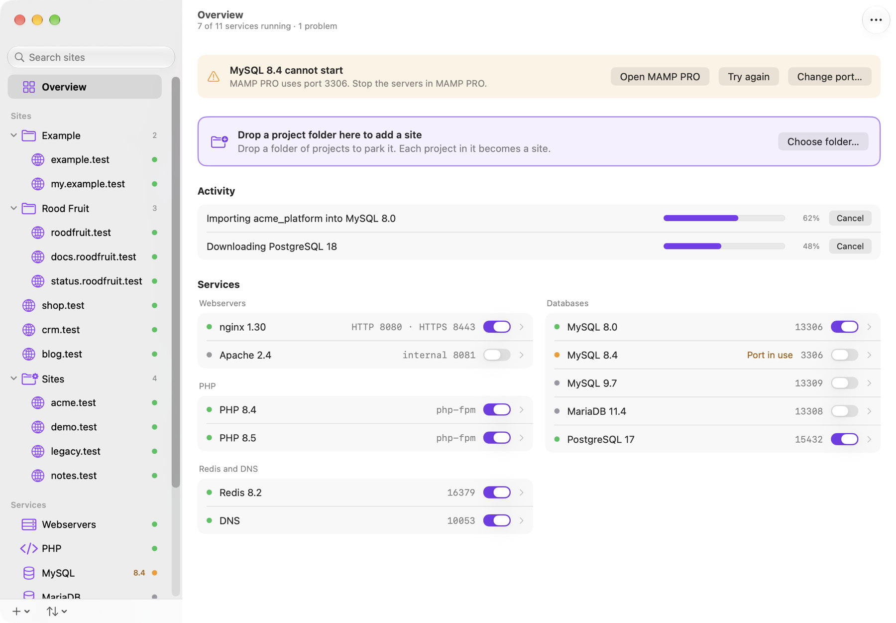

# Nexus

Nexus runs your local PHP websites on macOS. It gives each site a domain with a trusted certificate,
and it installs PHP, Node, nginx, Apache, MySQL, MariaDB, PostgreSQL and Redis for you.

Nexus also gives each git worktree its own workspace. A workspace has its own domain, its own
database server with a copy of your data, its own Redis indexes and its own queue workers. A new
worktree is ready within seconds, also with a large database. So you can work on many branches at
the same time, and a tool such as Claude Code can open a worktree that you can test at once.



## Requirements

- A Mac with Apple silicon
- macOS 27 or later
- git, for workspaces

## Install

1. Download `Nexus.dmg` from the [latest release](https://github.com/NexusLocal/nexus/releases/latest).
2. Move Nexus to the Applications folder and open it.
3. Follow the first steps of the app:
   - Allow Nexus to run in the background. The helper sends each `.test` name to Nexus.
   - Trust the Nexus certificate. macOS asks for your password one time.
   - Choose the versions of PHP, Node and the databases that you need.
   - Click Done. Nexus starts the services that you chose.

Nexus updates itself. See Settings > Updates.

## Add a site

Click + in the sidebar and choose the folder of your project. You can also use the command line:

```sh
cd ~/Sites/shop
nexus site add . --php 8.4
```

The site opens on `https://shop.test`. To make each folder in `~/Sites` a site, run `nexus park ~/Sites`.

## Bring a database

Open a database service in the app and choose Import database, or run this command:

```sh
nexus db copy shop --to mysql-8.4
```

Nexus reads the other server and changes nothing on it. The default account of a new instance is
`root` without a password.

## Workspaces

Make a git worktree of a site. Nexus makes the workspace by itself:

```sh
git worktree add ../shop-ticket-1 -b ticket-1
cd ../shop-ticket-1
nexus workspace wait
```

The last command prints the URL, for example `https://shop-ticket-1.test`.

A Laravel application gets the following:

- **Database:** a server of its own on a clone of the data folder. Your database names stay the same.
  Only the connection keys in `.env` change. Nexus then asks the application which server it reaches.
- **Redis:** indexes of its own.
- **Files:** clones of `vendor`, `node_modules`, the build output and `storage/app`. They use almost
  no disk until a file changes.
- **Programs:** its own queue worker, scheduler, Reverb server and Vite server, when the application
  uses them.
- **Migrations:** `php artisan migrate --force` runs after the clone. You can change this list on the
  Site screen.

Each workspace server uses about 200 MB of memory.

For the clone, Nexus freezes MySQL and MariaDB for about a second. A writer waits and then continues.
PostgreSQL needs no freeze. When the freeze fails, the workspace shows Not isolated with the reason,
and Retry tries again. A workspace that is not isolated runs no programs and no commands.

A database name stays the same in a workspace. So a command that connects itself must use
`{port:database}`, the port of the database server of the workspace.

When you run `git worktree remove`, Nexus removes the workspace and keeps a dump of its databases in
the trash for 7 days. To get a dump back, run `nexus db dumps` and `nexus db restore`.

A site can add its own keys to the `.env` of each workspace:

```sh
nexus site edit shop.test --workspace-key SCOUT_PORT={port:scout}
```

## Command line

Turn on Add Nexus to PATH in the settings of Nexus to use the `nexus` command in your terminal. Run
`nexus --help` for all commands, or open the Command line page in the app.

```sh
nexus status                  # the services and their state
nexus site list               # the sites
nexus workspace list          # the workspaces
nexus workspace info --json   # the URL, the databases and the ports of a workspace
nexus php -v                  # the PHP of the site in this folder
nexus composer install        # Composer with that PHP
```

## Build from source

You need Xcode 27. Copy `Config/Signing.local.xcconfig.example` to `Config/Signing.local.xcconfig`,
set your team and open `Nexus.xcodeproj`.

## Activity log

Nexus writes what happens to `~/Library/Application Support/Nexus/logs/activity.log`, so you can see
what went wrong. It holds the names of the buttons that you click, the requests to `nexusd` and their
results. It does not hold typed text, passwords or `.env` values. The file stays on your Mac, and
Nexus keeps at most about 10 MB. To open it, use the "..." menu on the Overview screen.

## Uninstall

Open Settings > Advanced and click Uninstall. Nexus then moves itself to the Trash. You can also run
`nexus uninstall` and move Nexus to the Trash yourself. Your packages and databases stay in
`~/Library/Application Support/Nexus` until you delete that folder.
